# KGT AI Hub — End-to-End Process Flow

How a company goes from "never heard of us" to "two trained bots answering
customers on its website", and what happens inside the platform at every step.

This document is the **process** view: the order things happen in, what is
written where, and which decision is taken by which piece of code. For the
reference view (schema fields, env vars, API tables) see
[DOCUMENTATION.md](../DOCUMENTATION.md); for the test view see
[TESTING.md](../TESTING.md).

*Describes the platform at commit `0b03e3c` (16 October 2026). When behaviour changes, update the section that quotes the number.*

## Contents

1. [The journey at a glance](#1-the-journey-at-a-glance)
2. [Actors, surfaces and credentials](#2-actors-surfaces-and-credentials)
3. [Stage 1 — Signup and activation](#3-stage-1--signup-and-activation)
4. [Stage 2 — Knowledge ingestion](#4-stage-2--knowledge-ingestion)
5. [Stage 3 — Readiness audit](#5-stage-3--readiness-audit)
6. [Stage 4 — Deployment onto the website](#6-stage-4--deployment-onto-the-website)
7. [Stage 5 — One chat turn, end to end](#7-stage-5--one-chat-turn-end-to-end)
8. [Stage 6 — Handoff, ticket, lead, follow-up](#8-stage-6--handoff-ticket-lead-follow-up)
9. [Stage 7 — Operating the workspace](#9-stage-7--operating-the-workspace)
10. [Cross-cutting flows](#10-cross-cutting-flows)
11. [Data lifecycle map](#11-data-lifecycle-map)
12. [Code index — which file owns which step](#12-code-index--which-file-owns-which-step)

---

## 1. The journey at a glance

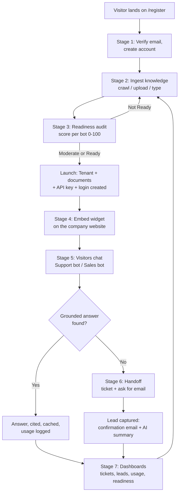

The loop at the bottom is the point of the product: what the bots could not
answer shows up as tickets and gaps in the dashboard, the company adds the
missing content, and the next readiness audit scores higher.

### Stage summary

| Stage | Trigger | Who acts | Produces | Typical duration |
|---|---|---|---|---|
| 1. Signup | Visitor opens `/register` | Visitor | `Tenant`, `TenantUser`, `TenantApiKey`, `TenantDocument[]`, `TenantConsent` | 5–15 min |
| 2. Ingestion | Wizard step 4, or dashboard → Documents | Visitor / client | `TenantDocument` rows, chunked and scoped | seconds–30 s per source |
| 3. Readiness audit | Wizard step 5, or dashboard → Training check | System (1 LLM call) | report + score, `Tenant.readiness*` | 5–20 s |
| 4. Deployment | Client copies the embed snippet | Client's webmaster | live widget | minutes |
| 5. Chat turn | A website visitor sends a message | End visitor | `ChatSession`, `ChatMessage`, `UsageLog` | 1–4 s |
| 6. Handoff | Low confidence, or visitor asks for a person | System | `SupportTicket`, `Lead`, emails | instant + background |
| 7. Operate | Any time | Client / KGT staff | document edits, key rotation, lead status | ongoing |

---

## 2. Actors, surfaces and credentials

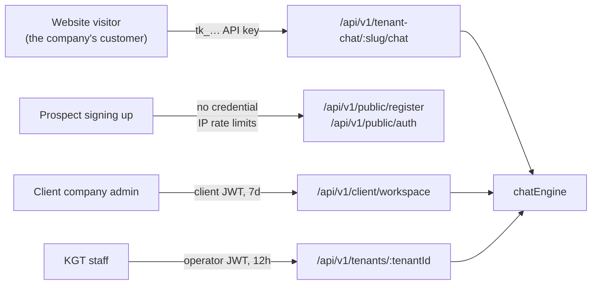

| Actor | Enters at | Credential | Scope of reach |
|---|---|---|---|
| Prospect | `/register` | none — IP rate-limited | nothing persistent until `/register/complete` |
| Client company | `/login` | `client` JWT (7 days) | exactly one tenant, resolved server-side from the `TenantUser` row |
| Website visitor | the company's own site | `tk_…` key (stored SHA-256) | chat only, for the tenant that owns the key |
| KGT staff | `/admin/login` | `operator` JWT (12 h) | every tenant |

Tokens are **typed** (`operator`, `client`, `signup`, `reset`), so a client
token presented on a staff route is rejected and vice versa
([authTokens.js](../apps/api/src/utils/authTokens.js)). The workspace router is
shared by clients and staff but only ever reads `req.tenant`, which each
gatekeeper sets — so there is one code path and one isolation rule, not two.

---

## 3. Stage 1 — Signup and activation

The wizard is six screens
([apps/web/pages/register.js](../apps/web/pages/register.js), `STEPS`):
**Account → Company → Choose bots → Knowledge → Training → Review & launch.**
Nothing is persisted until the final step, so an abandoned signup leaves no rows
behind.

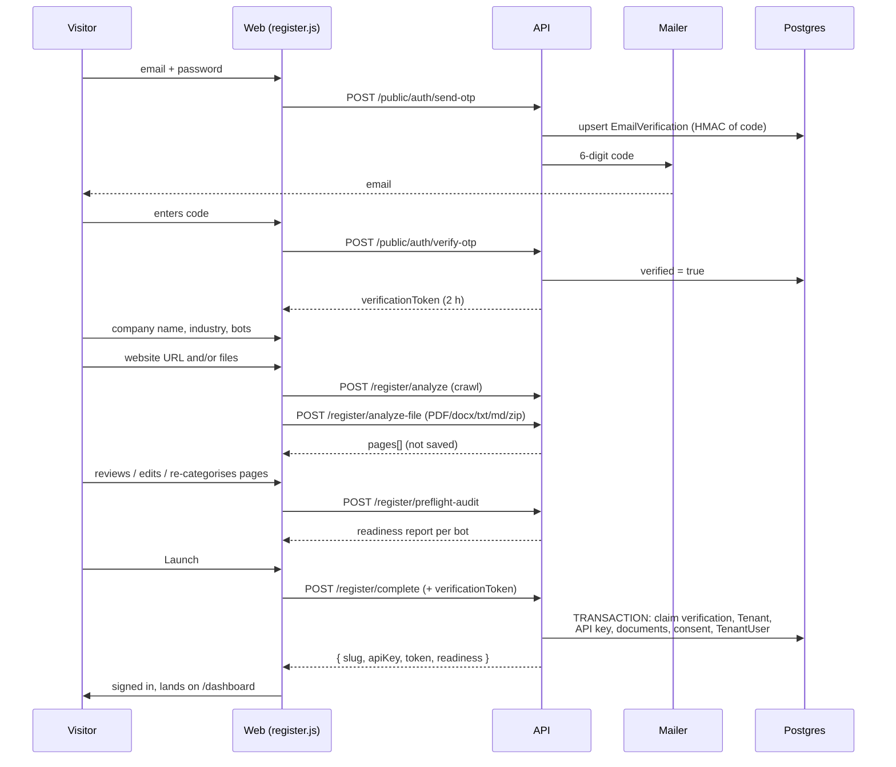

### Step-by-step

| Step | Endpoint | What is validated | What is written |
|---|---|---|---|
| Email OTP sent | `POST /public/auth/send-otp` | email shape; refuses if an account exists; 60 s resend cooldown; 5/IP per 15 min, 5/address per hour | `EmailVerification` (HMAC of the code, 10 min TTL) |
| OTP verified | `POST /public/auth/verify-otp` | max 5 attempts per code, then locked; 20/IP per 15 min | `verified = true`; token valid 2 h |
| Website scan | `POST /register/analyze` | `authorized: true` is mandatory; SSRF check on every URL and redirect hop; 8/IP per 10 min | **nothing** |
| File upload | `POST /register/analyze-file` | one file, ≤ limit, type-sniffed (`%PDF-` magic bytes, not just the extension); 10/IP per 10 min | **nothing** |
| Readiness audit | `POST /register/preflight-audit` | ≥ 1 page; 12/IP per 10 min (each call costs an LLM call we pay for) | report held in memory, keyed by content hash |
| Launch | `POST /register/complete` | verification token present and unused; ≤ 40 pages, ≤ 20 000 chars each; password ≥ 10 chars; crawled pages require consent; 3/IP per hour | one transaction: `Tenant`, `TenantApiKey`, `TenantDocument[]`, `TenantConsent`, `TenantUser` |

([publicAuth.routes.js](../apps/api/src/routes/publicAuth.routes.js),
[publicRegister.routes.js](../apps/api/src/routes/publicRegister.routes.js))

### Why the two-phase split

`/analyze*` returns pages, `/complete` saves them. The content the bots train on
is therefore **exactly what the visitor reviewed and edited on screen** — not a
second crawl that might return something different. It also means a visitor who
drops out mid-wizard costs us a crawl, not a half-built tenant.

### Invariants enforced at launch

- **One account per email.** Checked before the transaction and again by the
  unique index on `TenantUser.email` — two racing signups cannot both win.
- **Verification is single-use.** `claimVerification` runs *inside* the
  transaction: the code is consumed only if the account is actually created.
- **Crawled content implies recorded consent.** Any page carrying a `sourceUrl`
  without a matching `websiteConsent` is a 400. The stored statement is the
  server's own copy of the text at that version, not whatever the client posted.
- **Every refusal is logged** with a masked address and a reason, so a signup
  that silently never completes is diagnosable later.

### Immediately after launch (background)

| Work | Started by | If it fails |
|---|---|---|
| Starter question generation | `scheduleFaqGeneration(tenantId)` | `TenantFaq.status = failed`; the sandbox falls back to generic chips |
| Readiness persisted | reviewed report, matched by content hash | a fresh audit is scheduled instead |

The response carries the plaintext API key — **the only time it is ever
visible** — plus a client JWT, so the wizard lands the new client straight on
their dashboard.

---

## 4. Stage 2 — Knowledge ingestion

Three ways in, one representation out.

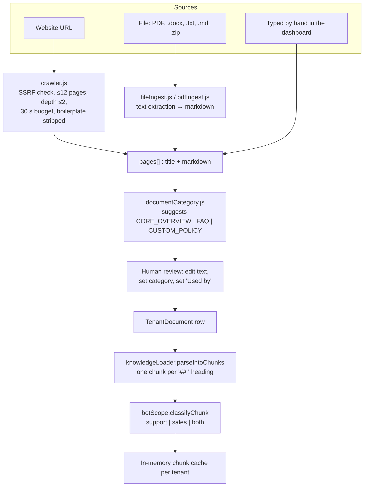

### Crawl tier

| Guard | Value | Where |
|---|---|---|
| Pages per crawl | 12 | `crawler.js` `MAX_PAGES` |
| Link depth | 2 | `MAX_DEPTH` |
| Per-request timeout | 8 s | `PER_REQUEST_TIMEOUT_MS` |
| Whole-crawl budget | 30 s | `TOTAL_BUDGET_MS` |
| Concurrency | 3 | `CONCURRENCY` |
| Redirect hops | 3, each re-checked for SSRF | `MAX_REDIRECTS` |
| Minimum real content | 30 words, else treated as a stub | `MIN_WORDS_PER_PAGE` |

Pages matching `about, faq, pricing, plans, support, help, contact, service,
feature` are crawled first, so a 12-page budget spends itself on the pages that
actually train a bot.

A JavaScript-only site returns 422 on the public route, which steers the visitor
to a file upload. The **headless-browser tier**
([crawlerBrowser.js](../apps/api/src/services/shared/crawlerBrowser.js)) exists
for those sites but runs **only on the authenticated operator route**, routes all
traffic through a loopback egress proxy with the same SSRF check, and is capped
at 8 renders / 60 s per crawl.

### Chunking and scoping

Each `TenantDocument.content` is treated exactly like one `.md` file: split into
one chunk per `## ` heading, with an optional `<!-- tags: a, b -->` line directly
under a heading. Every chunk then resolves to one bot scope:

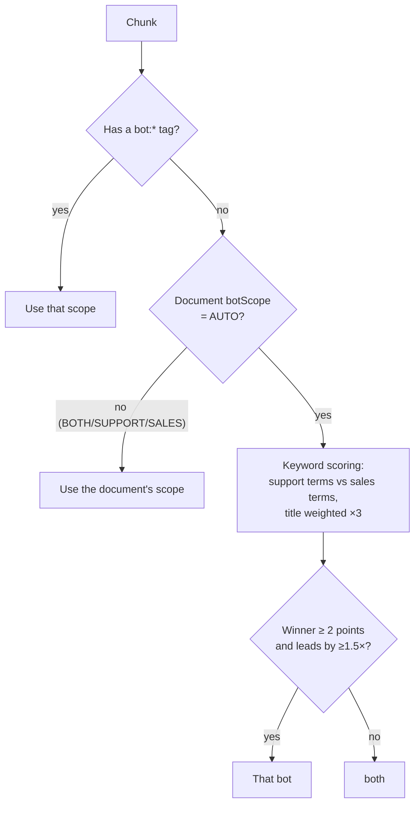

Then: **Support bot reads `support` + `both`; Sales bot reads `sales` + `both`.**
A company deploying only one bot has nothing to separate it from, so that bot
reads everything — a support-only company still wants its bot to know the price
list ([botScope.js](../apps/api/src/services/shared/botScope.js) `botCanUse`).

Ties and weak signals deliberately fall to `both`: wrongly hiding a section from
a bot is worse than letting both see it.

### Cache invalidation

Any add, edit, delete or scrape calls `invalidateTenantKnowledge(tenantId)`,
which drops **both** the tenant's chunk cache and its cached answers — an answer
written from the old documents must not outlive them. A read that was already in
flight when the invalidation happened is used for that one request but not
cached, tracked by a per-tenant generation counter
([tenantProfile.js](../apps/api/src/domains/tenantProfile.js) `loadTenantKnowledge`).

---

## 5. Stage 3 — Readiness audit

One LLM call grades the knowledge base against five pillars, then the **score is
computed in code**, never taken from the model
([botAuditor.js](../apps/api/src/services/botAuditor.js)).

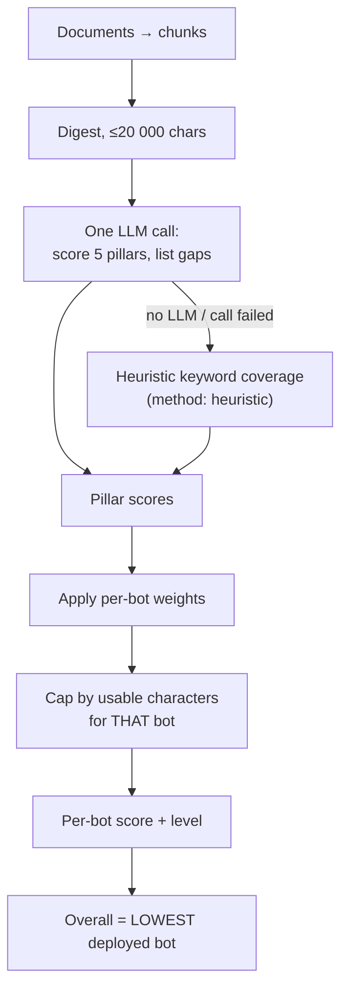

### Pillar weights

| Pillar | Support bot | Sales bot |
|---|---|---|
| Company identity & core offerings | 15 | 15 |
| Product / service features & specs | 20 | 25 |
| Pricing, packaging, licensing | 5 | 30 |
| Support manuals & troubleshooting FAQs | 60 | 0 |
| Sales pitch, objections, differentiators | 0 | 30 |

### Levels and caps

| Score | Level |
|---|---|
| ≥ 80 | Production Ready |
| 50–79 | Moderate |
| < 50 | Not Ready |

| Usable characters for that bot | Score cap |
|---|---|
| < 800 | 25 |
| < 2 500 | 60 |
| < 6 000 | 85 |

Two design decisions worth knowing:

- **The overall score is the lowest deployed bot's score, not the average.**
  "Production Ready" means every bot the company is launching is ready.
- **A content cap overrides a generous model.** An LLM asked to grade three short
  paragraphs will often be kind; a character count cannot be.

The report is stored on the `Tenant` row with a `readinessContentHash`. When the
documents change, the hash no longer matches and the dashboard marks the report
**stale** rather than showing a number that is no longer true.

---

## 6. Stage 4 — Deployment onto the website

The dashboard hands over one script tag
([EmbedSnippets.js](../apps/web/components/workspace/EmbedSnippets.js)):

```html
<script src="https://YOUR-API-HOST/widgets/tenant-chat-widget.js"
        data-tenant-id="acme-a1b2c3"
        data-api-key="tk_..."
        data-bot="sales" defer></script>
```

| Attribute | Meaning |
|---|---|
| `data-tenant-id` | the tenant **slug** — the routing key for `/tenant-chat/:slug/chat` |
| `data-api-key` | the `tk_…` key; sent as `X-Tenant-Api-Key` |
| `data-bot` | `support` or `sales` — locks the widget to one bot, no toggle |
| `data-default-bot` | which bot opens first when `data-bot` is omitted (both, with a toggle) |
| `data-api-base` | override the API origin; defaults to the script's own origin |

Placement convention: **`sales` on public pages** (landing, pricing, marketing),
**`support` behind a login** (portals, dashboards, help centres).

The widget calls the API directly with `fetch()` — no iframe — which works
cross-origin because CORS is deliberately open for the widget file and the chat
endpoint only; every other route is restricted to the configured dashboard
origins ([corsPolicy.js](../apps/api/src/utils/corsPolicy.js)).

---

## 7. Stage 5 — One chat turn, end to end

This is the hot path. Every surface — widget, client dashboard sandbox, staff
console — enters the same function, so all three get identical validation, rate
limiting, session scoping and gating
([tenantChat.js](../apps/api/src/services/tenantChat.js) → [chatEngine.js](../apps/api/src/engine/chatEngine.js)).

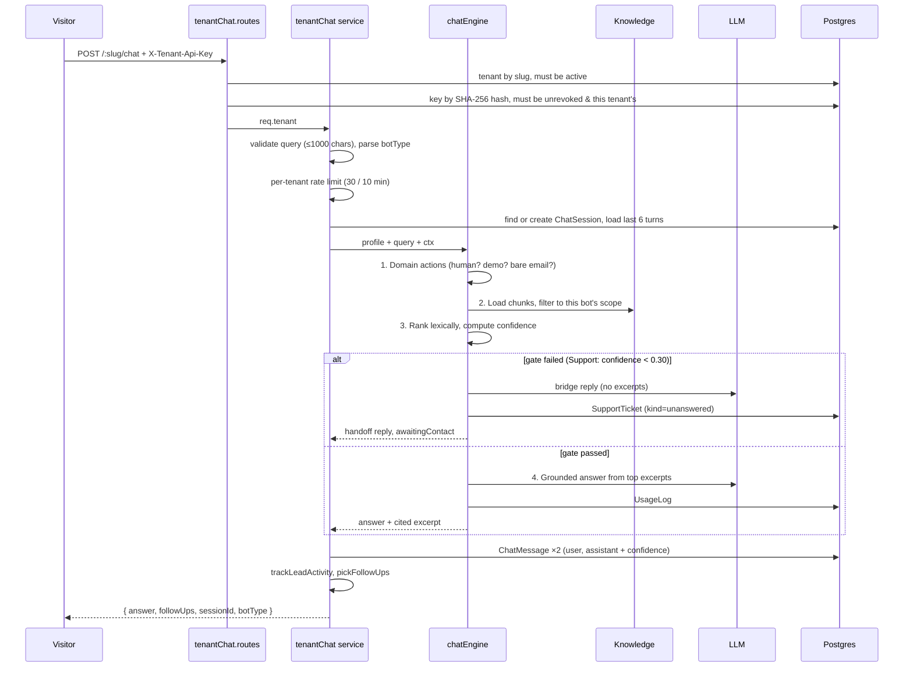

### The nine steps inside the engine

| # | Step | Detail |
|---|---|---|
| 1 | **Domain actions first** | A request for a person, a demo, or a bare email address is an *intent*, not a question — answered before retrieval so it can never fall into "I can't find that". Matching is deliberately narrow (≤ 200 chars, strict patterns): a false positive here would hide a real answer. |
| 2 | **Knowledge generation snapshot** | Taken *before* reading the knowledge, so a document edited mid-request cannot have its pre-edit answer cached. |
| 3 | **Load + scope** | Chunks from cache or DB, filtered to this bot's scope. |
| 4 | **Rank** | Lexical: Porter stemming, stop-word removal, exact-match bonus, typo correction against the tenant's own vocabulary. Per-bot category weights reorder; chunks below 35 % of the best score are dropped. |
| 5 | **Confidence** | A saturating curve `score / (score + k)` on the **unweighted** score — so a weight can change which excerpt the model reads first but can never lift a weak match through the gate. |
| 6 | **Gate** | **Support only.** `confidence < Tenant.minConfidence` (default 0.30) → the model is never called; straight to the fallback path. Exactly 0.30 passes. The **Sales** profile sets no `minConfidence`, so it is gated only on "no relevant chunks at all" — see below. |
| 7 | **Answer** | Cache hit, or one LLM call with the bot's persona, grounding rules and the top excerpts. Usage logged either way — a cache hit records 0 tokens and what it saved. |
| 8 | **Verify** | The model self-reports `SOURCE_EXCERPT: n`, trusted over rank[0]. A sentinel reply (`NO_ANSWER_IN_TENANT_KB`) means "not in these excerpts". |
| 9 | **Shape and record** | Markdown normalised to plain text with `•` bullets; `confidence` and `answered` stored on the `ChatMessage` but **never sent to the client**. |

### The two bots gate differently

This asymmetry is deliberate and easy to miss when reading the engine:

| | Support bot | Sales bot |
|---|---|---|
| `minConfidence` | `Tenant.minConfidence` (0.30 default) | **not set** |
| Pre-model gate | yes — below the threshold the LLM is never called | no — any relevant chunk reaches the model |
| `handoffBelow` | the same threshold | `Tenant.minConfidence` |
| Effect of the threshold | decides whether the bot answers at all | decides only whether a *no-answer* becomes a handoff or a request for more detail |

A support conversation should refuse rather than risk a wrong instruction. A
sales conversation should stay engaged — so the Sales bot always gets its chance
to answer from whatever matched, and the threshold is applied afterwards, to the
handoff decision only ([tenantProfile.js](../apps/api/src/domains/tenantProfile.js),
`createTenantSalesProfile`).

Both bots file tickets, both track usage, and both share the answer cache.

### Retrieval weights

| Category | Support bot | Sales bot |
|---|---|---|
| `FAQ` | ×1.35 | ×0.9 |
| `CUSTOM_POLICY` | ×1.15 | ×1.15 |
| `CORE_OVERVIEW` | ×0.85 | ×1.25 |

Plus one sector-neutral nudge: when the question is plainly about money or rules
(price, fee, refund, cancel, warranty, shipping, terms…), `CUSTOM_POLICY` chunks
get a further ×1.25 **for both bots** — "how much is it" should be answered from
the price sheet, not from a marketing paragraph that mentions price in passing.

### Why lexical, not vector

A deliberate trade-off: tenant knowledge bases are small and curated, lexical
scores are explainable to a client ("it matched these words in this section"),
they cost nothing per query, and they produce a stable confidence number that a
30 % gate can actually be set against.

### The three no-answer outcomes

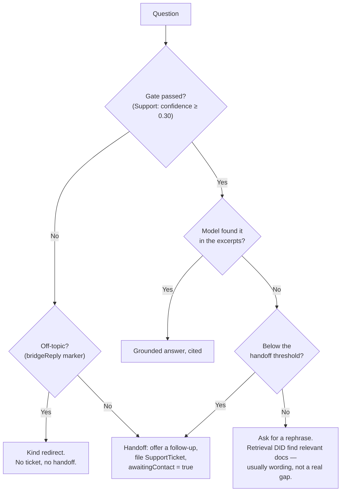

The **bridge reply** ([bridgeReply.js](../apps/api/src/engine/bridgeReply.js)) is
a contextual "I can't answer that, shall I get someone?" rather than one fixed
sentence. The model gets **no excerpts**, the prompt forbids answering, and
`acceptBridge()` discards any reply containing a number, link, list, step, or no
offer of follow-up. Better a plain fallback than a warm-sounding invented fact.

### Degradation when every LLM provider is down

`generateAnswer` tries `LLM_PRIMARY`, then each provider in `LLM_FALLBACK`,
moving on for any config error, rate limit, timeout (20 s default) or outage.
When all of them fail:

1. the reply is a polite "try again in a few minutes" — **never** a raw excerpt,
   which rarely answers the question and reads like an error;
2. a ticket is filed regardless of confidence, so the question is not lost;
3. one log line names every provider tried, so a dead primary key cannot hide
   behind a working fallback.

---

## 8. Stage 6 — Handoff, ticket, lead, follow-up

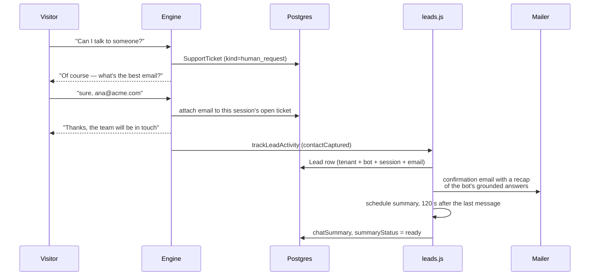

### Ticket kinds

| `kind` | Raised when | Confidence recorded |
|---|---|---|
| `unanswered` | below the confidence threshold | yes |
| `outage` | every LLM provider failed | whatever it was |

**Team alerts.** Beyond lead capture, the team is alerted when a reply lands
below `LOW_CONFIDENCE_ALERT_BELOW` (25% by default) or the bot hands a visitor
to a person. The widget is public, so these are throttled: one per conversation
per `ALERT_SESSION_COOLDOWN_MIN` (30 min) and at most
`ALERT_TENANT_MAX_PER_HOUR` (20) per tenant, lead alerts included in the same
cap. A throttled alert is logged, not lost — the conversation is in the
dashboard's Sessions view and the handoff is already a ticket.
`TEAM_ALERTS_ENABLED=false` turns all of it off.
| `human_request` | the visitor asked for a person | n/a |
| `demo_request` | the visitor asked for a demo or walkthrough | n/a |
| `contact_request` | an email was left after a reply that could not help | n/a |

### Lead rules

- **One row per conversation, bot and email.** Leaving the same address again
  updates the row rather than adding another.
- **The summary covers the whole chat.** The widget has no "conversation ended"
  signal, so every later turn re-schedules the summary for 120 s after the last
  message.
- **The confirmation email quotes only the bot's own answers** — never what the
  visitor typed. The address is unverified, so echoing chat input would let
  anyone send arbitrary text to any inbox from our sender address.
- **The recap includes only grounded answers** (`ChatMessage.answered = true`).
  Greetings, handoffs and "can't answer that" replies are never recapped.
- **One confirmation per address per tenant per day** in production
  (`LEAD_CONFIRMATION_COOLDOWN_HOURS`, 24 h default; off outside production so
  developers testing with their own address always get the mail).
- **Both sides are emailed.** The visitor gets the confirmation above; the
  tenant's own team gets an alert so someone can follow up while the visitor is
  still around (`services/teamAlerts.js`). Alerts go to the tenant's configured
  address, else its signup email, else its dashboard users — never to an address
  typed into the chat, so visitor-typed text only ever reaches addresses the
  tenant controls.

Email sending and summarisation both run in the background: the chat reply never
waits on them and never fails because of them.

---

## 9. Stage 7 — Operating the workspace

| Dashboard page | Shows | Backed by |
|---|---|---|
| Overview | readiness, document counts, recent activity | `GET /readiness`, `/usage` |
| Documents | every document, its category and "Used by"; add / scrape / upload / edit | `GET/POST/PATCH/DELETE /documents`, `POST /scrape` |
| Test bots | chat sandbox with starter questions, plus the knowledge split | `POST /chat`, `GET /faqs`, `GET /knowledge/distribution` |
| Tickets | what the bots could not answer | `GET /tickets` |
| Leads | captured emails, AI summaries, NEW/CONTACTED | `GET /leads`, `PATCH /leads/:id` |
| Usage | tokens, estimated cost, cache savings, daily chart | `GET /usage`, `/usage/daily` |
| Keys | issue, label, revoke | `GET/POST /api-keys`, `DELETE /api-keys/:id` |

### Recurring operational flows

**Key rotation (zero downtime)**

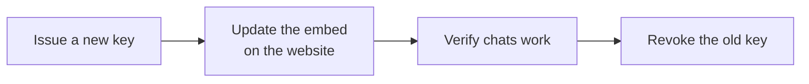

Keys are stored only as SHA-256 hashes, so a lost key is rotated, never
recovered. Revoking the last live key requires `?force=true` — the guard exists
because that single call takes a live widget offline.

**Password reset** — `POST /public/auth/forgot-password` → 6-digit code (hashed,
10 min, 5 attempts, single-use) → `POST /public/auth/reset-password`. Setting a
password stamps `passwordChangedAt`, which invalidates every session issued
before that moment: a reset signs the account out everywhere.

**Deactivating a company** — staff set `Tenant.active = false` in `/admin`. The
dashboard, every API key and the widget stop immediately; nothing is deleted.

**Wiping test data** — `npm run db:reset` (dry run) then `-- --yes`. Irreversible;
take a `pg_dump` first. `--with-showcase` re-creates the demo tenant.

---

## 10. Cross-cutting flows

### Authentication decision flow

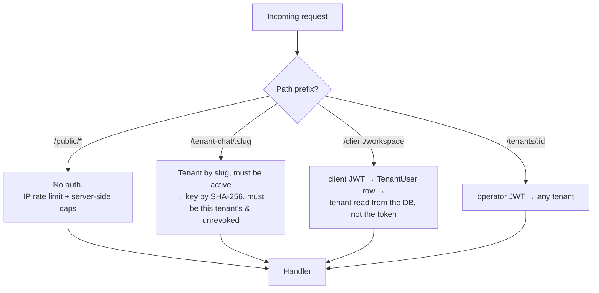

Isolation is structural, not a filter someone has to remember: every per-tenant
route reads the tenant **only** from the session, and looks up each document or
key id *together with* that tenant's id. Another company's row therefore reads
exactly like a row that does not exist.

### Caching layers

| Cache | Scope | Lifetime | Cleared by |
|---|---|---|---|
| Chunk cache | per tenant | process lifetime | any document change or scrape |
| Answer cache | tenant + bot + normalised question | 24 h TTL, 5 000 entries LRU | the same invalidation, via a generation counter |
| `lastUsedAt` write | per API key | at most every 5 min | — (bookkeeping, never blocks a chat) |

### Abuse controls

| Surface | Limit | Keyed by |
|---|---|---|
| Signup complete | 3 / hour | IP |
| Website analyze | 8 / 10 min | IP |
| File upload | 10 / 10 min | IP |
| Pre-flight audit | 12 / 10 min | IP |
| OTP send | 5 / 15 min + 5 / hour per address | IP, address |
| OTP verify | 20 / 15 min, 5 per code | IP, code |
| Chat | 30 / 10 min | **tenant**, not IP |

Chat is limited per tenant on purpose: it bounds each company's LLM spend
however many visitors its widget has.

### Startup validation sequence

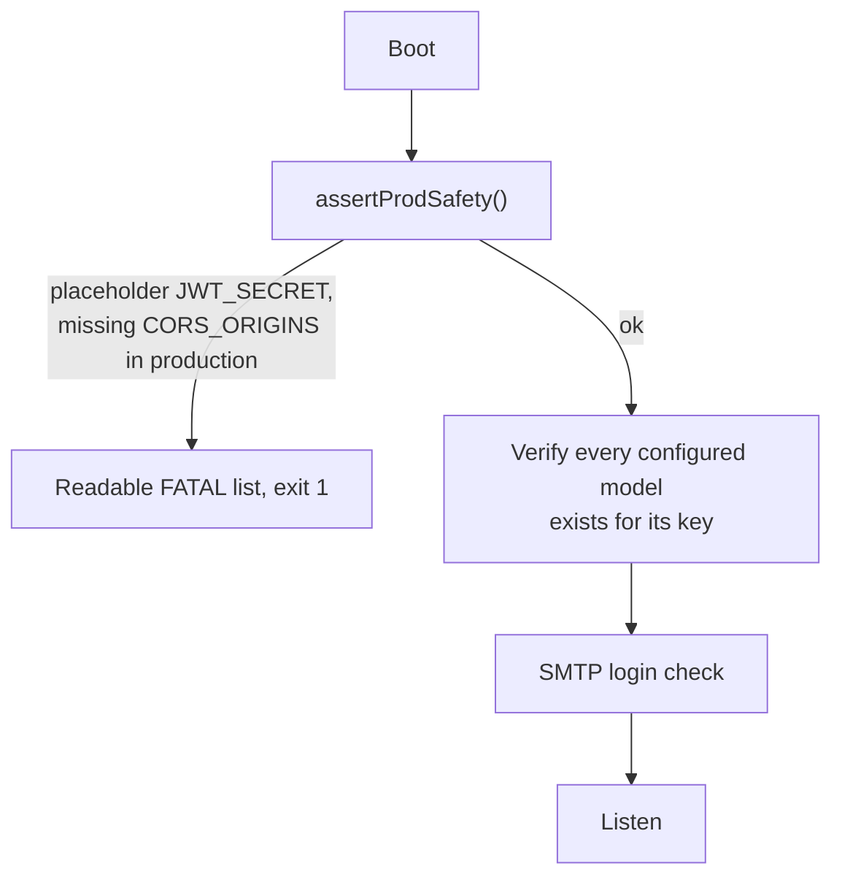

Config problems are caught at boot with an actionable message, not on the first
customer chat. Missing LLM keys and broken SMTP are loud warnings rather than
fatal — the rest of the platform works without them — except that in production
a missing mail transport is logged as an error, because every lead confirmation
and password reset would silently fail.

---

## 11. Data lifecycle map

What exists after each stage:

| Row | Created at | Updated by | Deleted |
|---|---|---|---|
| `Tenant` | `/register/complete`, or staff | settings, readiness, bot preference | staff only; cascades to everything below |
| `TenantUser` | `/register/complete` | login, password reset | with the tenant |
| `EmailVerification` | OTP send | verify, resend | consumed at `/complete` |
| `TenantApiKey` | launch, or `POST /api-keys` | `lastUsedAt`, `revokedAt` | never — revoked, kept for audit |
| `TenantDocument` | launch, upload, scrape, manual add | edits | by the client |
| `TenantConsent` | launch, when a crawl was authorised | — | with the tenant (audit record) |
| `TenantFaq` | background after ingestion | regeneration | with the tenant |
| `ChatSession` | first message of a conversation | — | with the tenant |
| `ChatMessage` | every turn | — | with the session |
| `SupportTicket` | handoff, outage, demo/human request | email attached, status | with the tenant |
| `Lead` | an email left in a chat | transcript, summary, status | with the tenant |
| `UsageLog` | every answer that cost (or saved) an LLM call | — | with the tenant |

Everything hangs off `Tenant` with `onDelete: Cascade`, so deleting a company
removes all of its data in one step — which is both the GDPR erasure path and
what makes `db:reset` safe to reason about.

---

## 12. Code index — which file owns which step

| Step in the flow | File |
|---|---|
| Wizard UI, six steps | [apps/web/pages/register.js](../apps/web/pages/register.js) + [components/signup/](../apps/web/components/signup/) |
| OTP send / verify, password reset | [publicAuth.routes.js](../apps/api/src/routes/publicAuth.routes.js), [verificationService.js](../apps/api/src/services/verificationService.js), [passwordResetService.js](../apps/api/src/services/passwordResetService.js) |
| Analyze / audit / complete | [publicRegister.routes.js](../apps/api/src/routes/publicRegister.routes.js) |
| Crawling | [crawler.js](../apps/api/src/services/shared/crawler.js), [crawlerBrowser.js](../apps/api/src/services/shared/crawlerBrowser.js) |
| File and PDF parsing | [fileIngest.js](../apps/api/src/services/shared/fileIngest.js), [pdfIngest.js](../apps/api/src/services/shared/pdfIngest.js) |
| Category suggestion | [documentCategory.js](../apps/api/src/services/shared/documentCategory.js) |
| Chunking | [knowledgeLoader.js](../apps/api/src/engine/knowledgeLoader.js) |
| Bot scoping | [botScope.js](../apps/api/src/services/shared/botScope.js) |
| Readiness audit | [botAuditor.js](../apps/api/src/services/botAuditor.js) |
| Chat entry (widget) | [tenantChat.routes.js](../apps/api/src/routes/tenantChat.routes.js) |
| One chat turn | [services/tenantChat.js](../apps/api/src/services/tenantChat.js) |
| Engine pipeline | [chatEngine.js](../apps/api/src/engine/chatEngine.js) |
| Personas, weights, prompts | [tenantProfile.js](../apps/api/src/domains/tenantProfile.js), [promptBuilder.js](../apps/api/src/engine/promptBuilder.js) |
| Ranking and confidence | [retriever.js](../apps/api/src/engine/retriever.js), [lexicalSearch.js](../apps/api/src/services/shared/lexicalSearch.js), [confidence.js](../apps/api/src/engine/confidence.js) |
| Provider chain | [llmClient.js](../apps/api/src/engine/llmClient.js) |
| Answer cache | [answerCache.js](../apps/api/src/engine/answerCache.js) |
| Handoff intents | [handoffActions.js](../apps/api/src/domains/handoffActions.js), [actionRegistry.js](../apps/api/src/engine/actionRegistry.js) |
| Contextual no-answer reply | [bridgeReply.js](../apps/api/src/engine/bridgeReply.js) |
| Tickets | [ticketing.js](../apps/api/src/engine/ticketing.js) |
| Leads, confirmations, summaries | [leads.js](../apps/api/src/services/leads.js), [mailer.js](../apps/api/src/services/mailer.js) |
| Follow-up chips | [followUps.js](../apps/api/src/services/followUps.js), [tenantFaqs.js](../apps/api/src/services/tenantFaqs.js) |
| Usage and cost | [usageTracking.js](../apps/api/src/engine/usageTracking.js), [usageStats.js](../apps/api/src/services/usageStats.js) |
| Client workspace API | [tenantWorkspace.routes.js](../apps/api/src/routes/tenantWorkspace.routes.js) |
| Staff API | [tenantAdmin.routes.js](../apps/api/src/routes/tenantAdmin.routes.js) |
| Auth middleware | [clientAuth.js](../apps/api/src/middleware/clientAuth.js), [operatorAuth.js](../apps/api/src/middleware/operatorAuth.js), [authTokens.js](../apps/api/src/utils/authTokens.js) |
| Embeddable widget | [tenant-chat-widget.js](../apps/api/public/widgets/tenant-chat-widget.js) |
| Startup guards | [assertProdSafety.js](../apps/api/src/utils/assertProdSafety.js), [server.js](../apps/api/src/server.js) |
